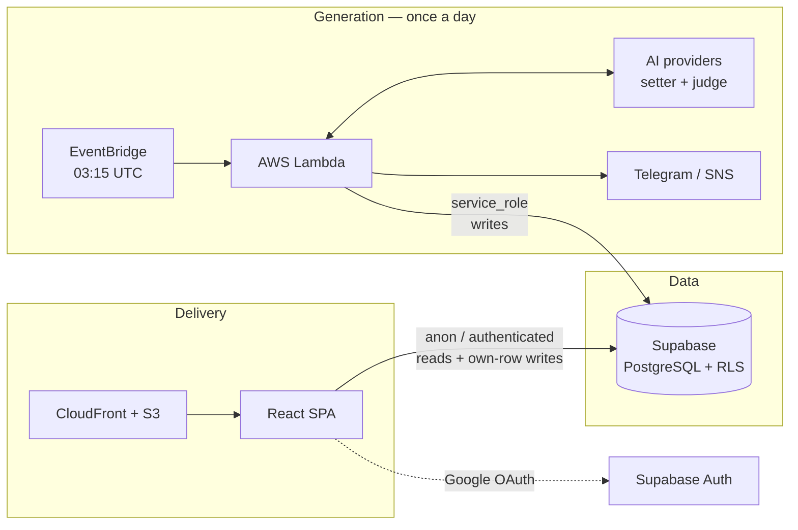
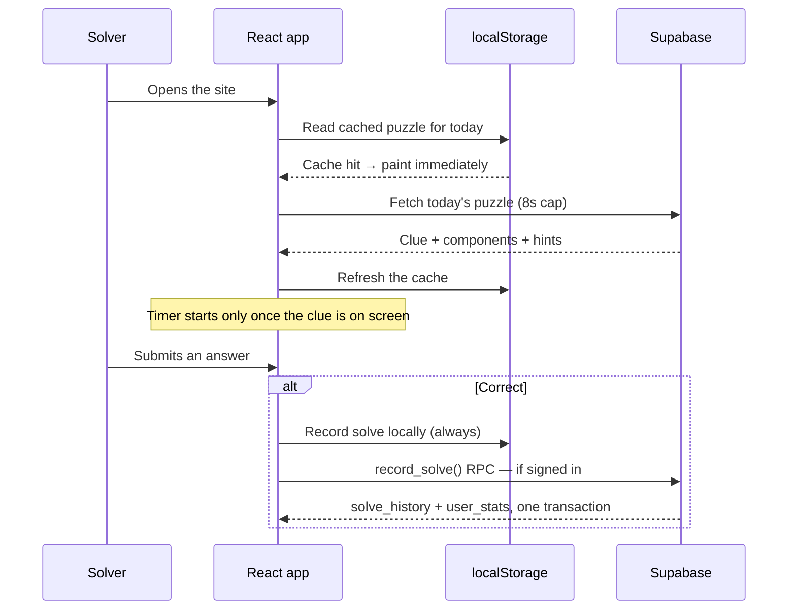

# Architecture

How The Cryptic Owl fits together, and why it is built this way.

---

## The shape of the system

Three pieces that barely talk to each other, joined by one Postgres database.



The separation matters: **the generator writes, the app reads.** The Lambda
holds the `service_role` key and is the only thing that can create a clue. The
browser holds the anon key and can only read what Row Level Security allows —
which is exactly the clues attached to a published `daily_puzzles` row, plus
its own user's rows. There is no admin surface in the SPA at all.

---

## Repository layout

```
├── src/                      React SPA
│   ├── app/
│   │   ├── pages/            One directory per route; heavy pages split further
│   │   │   ├── puzzle/       The daily game, broken into focused modules
│   │   │   └── history/      Lazy-loaded chart
│   │   ├── components/       Shared UI (the mascot)
│   │   ├── context/          Auth and dark-mode providers
│   │   ├── hooks/            useStreak, useClueReaction
│   │   ├── lib/              localStore — all browser-storage access
│   │   └── theme.ts          The design tokens
│   └── lib/supabase.ts       Every database call the frontend makes
│
├── lambda/                   Daily clue generator
│   ├── index.js              Handler, preflight, provider resolution
│   ├── core/
│   │   ├── pipeline.js       Attempt budget and orchestration
│   │   ├── generator/        Word selection, clue writing
│   │   ├── validator/        judge.js (gates) + mechanics.js (arithmetic)
│   │   └── builder/          Progressive hint construction
│   ├── clients/              Per-provider HTTP adapters
│   ├── constants/            Prompts, schemas, the provider registry
│   └── services/dbService.js Scheduling and persistence
│
├── supabase/migrations/      Schema, RLS policies, functions
└── docs/                     You are here
```

---

## How a solver's request flows



Three deliberate properties:

- **Stale-while-revalidate.** The cached clue paints first, then the network
  result replaces it only if it actually changed. A returning solver sees the
  clue instantly.
- **The local write always happens.** Signed-out and offline solvers still get
  a streak. The database sync is fire-and-forget on top.
- **The fetch is bounded.** Eight seconds, then the built-in practice clue.
  Without a cap, a blocked network left the page on its loading skeleton
  forever — an ad blocker filtering `*.supabase.co` is enough to cause it.

---

## Key decisions

### The generator and the app never share a code path

The Lambda is plain ESM JavaScript; the SPA is TypeScript. They share no
modules. That is a deliberate cost: the hint colour palette exists in both
places, and so does the wordplay-type list.

The alternative — a shared package — would couple the daily job's release
cadence to the frontend's. The generator runs once a day and must be boring;
the frontend ships whenever. Duplicating two small constant tables is the
cheaper trade. The database's lookup tables (`clue_wordplay_types`,
`clue_indicator_types`) are the source of truth that keeps them honest.

### Wordplay is verified in code, not by a model

Asking a language model "do these letters anagram to that word?" is asking it
to do the one thing it is worst at. `lambda/games/cryptic/validator/mechanics.js`
computes the answer directly and hands the *result* to the model, which is then
free to judge the things it is actually good at: surface reading, indicator
fairness, whether the definition is fair.

See **[the clue pipeline](./clue-pipeline.md)** for the full three-gate design.

### Display data is denormalised onto the clue row

`clues.clue_parts` and `clues.hints` are JSONB copies of what
`clue_components` already holds normalised. That is duplication on purpose: the
puzzle page is the most latency-sensitive screen in the product, and it can
render everything it needs from a single row with no join.

`clue_components` stays the authoritative structural record. The JSONB is a
cache — if the two ever disagree, the components are right.

### Visibility has exactly one gate

A clue is live **if and only if** it has a published row in `daily_puzzles`.
There is no `published` flag on `clues` itself, because two flags means two
places to get it wrong. The RLS policy on `clues` is a single `EXISTS`
subquery against `daily_puzzles`, indexed for it.

### The frontend's Supabase access is one module

Every database call lives in `src/lib/supabase.ts`. Nothing else imports the
Supabase client. That makes the app's entire data surface auditable in one
file, and it is why the SDK can be dynamically imported — 228 KB that stays off
the critical path and loads in parallel with first paint.

### Offline is a first-class state, not an error

`useOnlineStatus` watches the browser's `online`/`offline` events, and `Root`
swaps the content area for a dedicated screen while the browser reports no
connection. The nav and footer stay, so nobody is stranded.

`navigator.onLine` is only trustworthy in one direction — `false` reliably
means offline, `true` merely means an interface is up. So it is used solely to
recognise the *definitely offline* case and explain it. Requests that fail
while the browser believes it is online are handled where they are made, by the
8-second timeout in `src/lib/supabase.ts`.

The screen recovers on its own when the connection returns, without a reload
and without losing the route.

### Storage access is one module too

`src/app/lib/localStore.ts` owns every `localStorage` read and write, namespaced
under `tco-`. Centralising it is what makes sign-out able to clear user data
completely, the dated puzzle cache able to be pruned, and a private-browsing
window able to fail gracefully instead of throwing.

---

## Performance model

The critical path is: HTML (with inlined CSS) → React + Motion + icons → first
paint → Supabase chunk → clue.

| Technique | Why |
|---|---|
| CSS inlined into `index.html` | Removes a render-blocking round trip |
| Supabase SDK dynamically imported | 228 KB off the critical path |
| `LazyMotion` + `m.*` primitives | ~25 KB of Motion instead of ~130 KB |
| Auth restore deferred to `requestIdleCallback` | Session hydration stops competing with first paint |
| Recharts behind `React.lazy` | 530 KB that most solvers never download |
| Routes code-split | Only the puzzle page ships in the initial bundle |
| GA gated behind first interaction | No analytics cost for a bouncing visitor |
| Assets immutable, HTML `no-store` | A deploy is visible immediately; assets cache for a year |

CI enforces a **bundle budget** (`scripts/check-bundle-budget.mjs`) so this
cannot silently regress: index.html ≤ 40 KB gzipped, critical-path JS ≤ 110 KB,
any single lazy chunk ≤ 200 KB.

---

## What is deliberately *not* here

- **No server.** The SPA talks to Supabase directly; RLS is the authorisation
  layer. There is no API tier to secure, scale or pay for.
- **No admin UI.** Approving a submitted clue is a SQL function
  (`approve_clue_submission`) called by someone with database access.
- **No state-management library.** Two React contexts and a module-level store
  behind `useSyncExternalStore` cover everything.
- **No component library.** The app is ~10 screens with a specific visual
  identity; a generic primitives library earned its removal.
- **No service worker.** The app needs a network connection to load. See
  [the roadmap](./roadmap.md).
