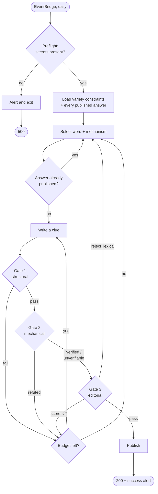

# The clue pipeline

How one cryptic clue gets written, verified and published every day.

This is the part of the system where being wrong is most expensive: a broken
clue is not a degraded experience, it is an unsolvable one, and it is the only
thing on the page.

---

## What a cryptic clue is

Every clue has exactly two parts that overlap in the surface reading:

> **Small boat** when **ocean** is **disturbed** (5)
>  ↑ definition   ↑ fodder   ↑ indicator

- The **definition** (`Small boat`) plainly defines the answer, and must sit at
  the very start or very end of the clue — the Ximenean rule.
- The **wordplay** independently produces the same letters. Here the
  **indicator** (`disturbed`) signals an anagram, and the **fodder** (`ocean`)
  supplies the letters. `OCEAN` → `CANOE`.

Both halves must arrive at `CANOE`. A clue where only one does is broken, and
the reader has no way to tell which half failed.

---

## The run



**Budget:** 9 AI generations per run, 3 clue attempts per word. Gates 1 and 2
cost nothing, so a clue rejected on arithmetic is free — only gate 3 spends a
call.

---

## Gate 1 — structural

`lambda/games/cryptic/validator/judge.js` → `structuralErrors()`. Pure, synchronous, no
network.

JSON schema mode guarantees the *shape* of the model's output and nothing
about its contents — empty strings, whitespace and nonsense all pass it. This
gate checks the contents:

| Check | Rejects |
|---|---|
| Core fields present | Empty or whitespace-only clue/definition |
| Segment integrity | A *typed* `clue_parts` segment with no real text |
| Meta-commentary | `"Here's my clue:"`, code fences, `"let me rephrase"` |
| Answer leakage | The answer appearing in the clue (except `hidden`, where it must) |
| Ximenean extremity | A definition stranded in the middle of the clue |
| Reconstruction | `clue_parts` that don't join back into the clue string |
| Exactly one definition | Zero, or two, segments tagged `definition` |
| Disjointness | Fodder sitting entirely inside the definition |
| Indicator presence | An indicator that doesn't appear in the clue text |
| Letter count | `(5)` on a six-letter answer |

The meta-commentary patterns are deliberately narrow. `wait`, `actually` and
`here` all appear naturally in cryptic surfaces; only anchored openers and
explicit self-correction phrasing are banned.

> **A note on whitespace.** Structural segments — the connective tissue between
> the definition, fodder and indicator — are very often a single space. The
> canonical hidden-word example in the generator prompt contains
> `{ "text": " ", "type": null }`. Requiring meaningful text on *every* segment
> rejected correctly-formed clues; only typed segments must carry content.

---

## Gate 2 — mechanical

`lambda/games/cryptic/validator/mechanics.js`. Also pure, also free.

This gate computes the wordplay arithmetic directly. It exists because letter
counting is the single thing language models are worst at, and it is also the
single thing that is trivially decidable in code.

Each verifier returns one of three verdicts:

| Verdict | Meaning | Effect |
|---|---|---|
| `VERIFIED` | The letters work out exactly | The judge is told, and told *not* to overturn it |
| `REFUTED` | Literal-only mechanism, letters don't work | **Rejected — no AI call** |
| `UNVERIFIABLE` | The fodder is a synonym; not decidable here | Passed to the judge with a precise note |

### The literal / substitutable split

This is the important design decision.

**Literal-only mechanisms** take their fodder straight off the clue surface.
Cryptic convention does not permit a synonym there, so a failed check is a
genuine refutation:

- `hidden` — the answer must be spelled out consecutively in the clue, and
  must straddle at least one word boundary. An answer sitting wholly inside a
  single word is unfair form: the solver has no gap to spot.
- `initial_letters` / `final_letters` — first or last letter of each
  consecutive fodder word.
- `alternating_letters` — odd- or even-indexed letters.

**Substitutable mechanisms** routinely operate on a synonym of a word in the
clue (`flower` → `ROSE` → anagram fodder). A failed literal check there proves
nothing, so it becomes `UNVERIFIABLE` rather than a rejection:

- `anagram`, `reversal`, `container`, `deletion`, `charade`

**Opaque mechanisms** have no decidable arithmetic at all — they turn on
pronunciation or on combining several tricks:

- `homophone`, `spoonerism`, `cryptic_definition`, `andlit`, `compound`

### Worked examples

```
anagram      OCEAN → sorted ACENO; CANOE → sorted ACENO            ✓ VERIFIED
reversal     REWARD reversed → DRAWER                              ✓ VERIFIED
hidden       "la·SERPENT·agram" spans laser|pentagram              ✓ VERIFIED
hidden       "A serpentine road" — inside one word                 ✗ REFUTED
initials     Some People Enjoy Awfully Rich → SPEAR                ✓ VERIFIED
alternating  w·A·s·H·t·U·b from "wears the thumbs", odds           ✓ VERIFIED
charade      CAR + PET → CARPET                                    ✓ VERIFIED
charade      doctor + love → DR + O                                ? UNVERIFIABLE
container    CAR inside S·E → SCARE                                ✓ VERIFIED
deletion     BRANCH beheaded → RANCH                               ✓ VERIFIED
anagram      HOUSE vs CANOE — same length, different letters       ? UNVERIFIABLE
```

Covered by 46 tests in `mechanics.test.js`, using real cryptic examples.

---

## Gate 3 — editorial

A separate, cheaper model at temperature 0.1 scores the clue on the things code
cannot judge: surface reading, indicator fairness, whether the definition
genuinely means the answer, overall publishability.

**The mechanical verdict is handed to it.** This is what makes the gate work:

- On `VERIFIED`, the prompt says the arithmetic is confirmed and instructs the
  model not to fail the clue on arithmetic grounds. This removes the largest
  source of *false rejections* — a model talking itself out of a correct
  anagram.
- On `UNVERIFIABLE`, the prompt names the exact substitution to check, so the
  model's attention goes to the one thing code could not settle.

A clue ships only when **all** of these hold:

```
valid === true  AND  wordplay_correct === true  AND  score >= 7
```

### Fail-safe

If the judge is unreachable the clue is **rejected**, never shipped. An
unreviewed clue never reaches a solver.

Three consecutive judge outages abort the whole run rather than quietly
draining the attempt budget — the judge being down is not a per-attempt
problem, and retrying cannot help.

---

## Choosing providers

Six providers are wired: `gemini`, `openai`, `claude`, `deepseek`, `grok`,
`mistral`. Two independent knobs:

```bash
AI_PROVIDER=claude       # who writes the clue
JUDGE_PROVIDER=gemini    # who reviews it
```

Leaving `JUDGE_PROVIDER` unset makes the judge follow the setter (each
provider's judge client already uses a cheaper model at lower temperature).

**Running two different families is the better configuration.** A setter and a
reviewer from the same family tend to share blind spots on the same clue — the
reviewer is most likely to miss exactly the mistakes the setter is most likely
to make.

Preflight requires **both** providers' keys. See
[`ai-providers.md`](./ai-providers.md) for measured costs and quality.

---

## Variety and uniqueness

Two different concerns, handled differently:

- **Variety** (`avoidAnswers`, `avoidTypes`) — answers used in the last 14
  days, and any mechanism used 3+ times in that window, are injected into the
  word-selection prompt. A short list keeps the prompt small.
- **Uniqueness** (`knownAnswers`) — `clues` has a `UNIQUE` index on
  `(answer, answer_pattern)`, so a repeat answer is not a style problem, it is
  an insert that fails at the very end of the run after every AI call has been
  paid for. The pipeline screens the proposed word against every published
  answer *before* generating, and re-selects for free.

Words abandoned during a run are also fed back into the planner, so attempt 5
does not re-propose the word attempt 2 already rejected.

---

## Scheduling

Target date is `max(today, latest_in_db + 1)`:

- **`today`** means a missed run — quota exhaustion, an outage — fills the
  current day forward rather than leaving a gap.
- **`latest + 1`** means a second invocation on the same day schedules
  tomorrow instead of colliding.

In steady state this keeps exactly one day of buffer ahead of the solver.

The write is not transactional (Supabase's REST interface has no multi-statement
transaction). If the `daily_puzzles` insert fails, the orphaned `clues` row is
deleted on a best-effort basis, which closes the window where it could survive a
failed run.

---

## Progressive hints

Four cards, built at generation time by `core/builder/hintBuilder.js` and
stored in `clues.hints`:

| # | Reveals |
|---|---|
| 1 | Which end of the clue the definition is at |
| 2 | The indicator word, and which trick it signals |
| 3 | What *kind* of material to look for — **never which word it is** |
| 4 | The mechanism, explained in full |

Hint 3 is the one that matters. Naming the fodder hands over the near-answer a
full step early and flattens the whole curve, so hint 3 describes the mechanism
generically ("a word in the clue has the same letters as the answer, just
scrambled") and leaves the spotting to the solver.

The frontend prefers the stored progression and falls back to deriving one from
`clue_components` only for human-authored clues, which do not populate `hints`.
Both paths follow the same anti-spoiler rule, and both are covered by tests
that assert the fodder never appears.

---

## Observability

Every run alerts on both channels with the outcome:

- **Success** — puzzle number, answer, mechanism, the clue, judge scores,
  whether the arithmetic was code-verified, attempts used, and which providers
  ran.
- **Failure** — the error, plus per-stage rejection counts. Many mechanical
  rejections point at the generator prompt; many editorial ones point at the
  quality bar or the model.
- **Quota exhaustion** — named separately, because retrying cannot help and the
  fix is billing, not code.

Alerting is best-effort by construction: a broken alert channel must never fail
the run it is reporting on.

`clue_quality_by_mechanism` (migration 002) aggregates judge scores and
code-verified share per mechanism. It is the view to check after changing a
prompt — a mechanism whose `verified_pct` drops is producing clues the verifier
can no longer confirm.

---

## Testing

145 tests across the Lambda, with coverage thresholds enforced in CI on
`lambda/games/cryptic/**`:

| File | Covers |
|---|---|
| `mechanics.test.js` | 46 tests — every mechanism, real cryptic examples, the literal/substitutable split |
| `judge.test.js` | 31 tests — each structural check, gate ordering, fail-safe behaviour |
| `pipeline.test.js` | 11 tests — budget, feedback loop, abandonment, dedupe, outage handling |
| `hintBuilder.test.js` | 21 tests — including that no hint ever leaks the answer or fodder |
| `dbService.test.js` | 15 tests — scheduling, attribution, rollback, duplicate handling |
| `_schemaUtils.test.js` | 10 tests — cross-provider schema conversion |
| `index.test.js` | 11 tests — preflight and provider resolution |

The gates are pure functions over plain data, which is what makes this cheap.
Adding a mechanism means adding a verifier and its tests — see
[CONTRIBUTING.md](../CONTRIBUTING.md).
