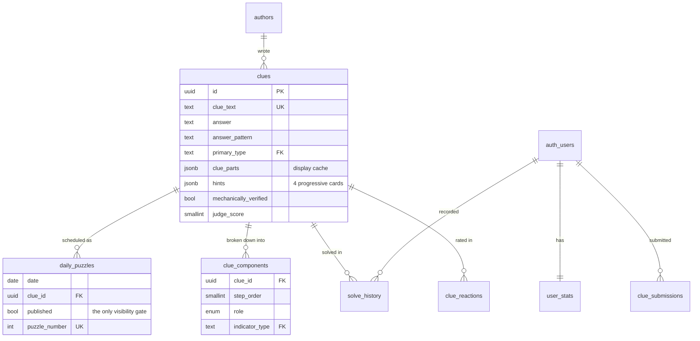

# Database

Schema, the authorisation model, and the invariants the app depends on.

Migrations live in [`supabase/migrations/`](../supabase/migrations/). For
first-time setup, see [`supabase-setup.md`](../supabase/supabase-setup.md).

---

## Model

### Table roles

| Table | Purpose |
|---|---|
| `clues` | One cryptic clue. All display data denormalised for zero-join page loads. |
| `daily_puzzles` | Maps a calendar date → clue. A join table, so multi-clue crosswords later need no change to `clues`. |
| `clue_components` | Normalised, one-row-per-ingredient breakdown. **Authoritative** structural record. |
| `authors` | Clue authors — the AI providers, and human contributors. |
| `user_stats` | One row per user: streak, XP, level, totals. |
| `solve_history` | One row per (user, clue). Cryptic only; feeds XP and the cryptic streak. |
| `game_puzzles` | One row per (game, puzzle date) for every game but cryptic: the frontend-ready payload, its source keys and the review record. Written by the per-game Lambdas; see [lambdas.md](./lambdas.md). |
| `game_plays` | One row per (user, game, puzzle date): the first finish of every daily game, with time, hints, mistakes and result. Written by the browser; see `src/app/games/playHistory.ts`. |
| `clue_reactions` | Per-user 👍/👎 on a clue. |
| `clue_submissions` | Community-submitted clues. The site no longer has a submit form; kept for existing rows. |
| `app_likes` | Anonymous global appreciation counter. |
| `clue_wordplay_types`, `clue_indicator_types` | Lookup tables — TEXT, not enums, so adding a value is an `INSERT` rather than an `ALTER TYPE`. |

---

## Invariants

These are what the application assumes. Breaking one breaks the app.

**1. A clue is live if and only if it has a published `daily_puzzles` row.**

There is deliberately no `published` flag on `clues` — two flags means two
places to get it wrong. The RLS policy is a single `EXISTS` subquery, and
`dp_clue_published_idx` exists specifically to support it. Unpublishing is
therefore one `UPDATE`, and it takes effect immediately for every reader.

**2. `clue_components` is authoritative; `clue_parts` and `hints` are caches.**

The JSONB columns are duplication on purpose — the puzzle page renders from a
single row with no join. If they ever disagree with the components, the
components are right.

**3. `answer` is uppercase A–Z only, with no spaces.**

Enforced by `CHECK`. Multi-word answers concatenate (`ROSEWATER`) and carry
their display form in `answer_pattern` (`4,5`). The answer input strips
non-letters as you type, so a solver typing `ROSE WATER` matches.

**4. `(answer, answer_pattern)` is unique.**

An answer can never be reused. The generator screens every candidate against
the full history *before* spending an AI call, because otherwise the collision
surfaces as a failed insert at the very end of a run.

**5. Stats are only ever written through `record_solve()`.**

`solve_history` and `user_stats` must agree. The RPC writes both in one
transaction, enforces `auth.uid() = p_user_id`, caps XP at 100, and is
idempotent per (user, clue). The one exception is
`syncLocalStatsToSupabase()`, which upserts `user_stats` directly on first
sign-in to carry signed-out progress across.

---

## Authorisation

There is no API tier. **Row Level Security is the entire authorisation layer,**
and the browser holds the anon key.

Both `ENABLE` and `FORCE` are applied to the game tables. `ENABLE` activates
policies for `anon`/`authenticated`; `FORCE` additionally stops the table owner
bypassing them.

| Table | `anon` | `authenticated` | `service_role` |
|---|---|---|---|
| `clues` | read published only | read published only | full |
| `daily_puzzles` | read published only | read published only | full |
| `clue_components` | read if parent published | read if parent published | full |
| `authors` | read | read | full |
| `user_stats` | — | own row | full |
| `solve_history` | — | own rows | full |
| `game_puzzles` | read up to tomorrow (UTC) | read up to tomorrow (UTC) | full |
| `game_plays` | — | read own; insert own (dates within 400 days) | full |
| `clue_reactions` | — | read own **(see gaps)** | full |
| `clue_submissions` | — | insert + read own | full |
| `app_likes` | insert + read count | insert + read count | full |

### What this means in practice

- **The answer is in the payload.** Any solver can read today's answer from the
  network tab. This is inherent to a client-rendered, offline-tolerant puzzle
  and is an accepted trade: the product is a teaching tool, not a competition.
- **`service_role` never reaches the browser.** It exists only in the Lambda's
  environment.
- **New tables are deny-by-default only if you enable RLS.** The grants at the
  end of migration 001 are broad (`GRANT ... ON ALL TABLES`); RLS is what makes
  them safe. A new table without `ENABLE ROW LEVEL SECURITY` is world-writable
  by any signed-in user.

---

## Known gaps

Documented because they are live, not because they are acceptable.

### `user_stats.level` is never written

`record_solve` updates `xp` but not `level`, so the column sits at 1 forever
while the frontend recomputes it from XP. Either compute it in the RPC or drop
the column.

---

## Migrations

Applied in order, each idempotent where it reasonably can be.

| File | Contents |
|---|---|
| `001_initial.sql` | Full schema, lookup tables, RLS policies, `record_solve()`, `approve_clue_submission()`, views, seed puzzle #1 |
| `002_pipeline_hardening.sql` | Author rows for DeepSeek/Grok/Mistral, `clues.mechanically_verified`, `clue_quality_by_mechanism` view |
| `003_game_plays.sql` | `game_plays` table for every game's play history, owner-only RLS (no update/delete: a recorded play is final) |
| `004_game_puzzles.sql` | `game_puzzles` table for the per-game Lambdas; public read up to tomorrow (UTC) so the generated-ahead buffer stays private |
| `005`–`007` | Game list changes and `puzzle_suggestions` (insert-only, throttled) |
| `008_hardening.sql` | Puzzles readable only once their date has begun somewhere (`puzzle_unlocked_through()`, UTC+14); owner-write `clue_reactions`; `record_solve` validates date, counts and that the clue is the day's; `app_likes` throttle; `clues.notes` hidden by column grants; `clue_solve_stats` owner-only |

Apply with `supabase db push`, or paste into the SQL editor.

### Adding one

1. Number it sequentially: `005_<what-it-does>.sql`.
2. Make it idempotent — `IF NOT EXISTS`, `ON CONFLICT DO NOTHING` — so a
   partial apply can be re-run.
3. If it adds a table, enable **and force** RLS, and write its policies in the
   same migration.
4. If it changes a shape the Lambda writes, update `lambda/games/cryptic/services/dbService.js`
   and its tests in the same change.

---

## Views

| View | Audience | Notes |
|---|---|---|
| `clue_reaction_counts` | anon, authenticated | Aggregate 👍/👎 per clue, no `user_id` exposed. Currently always zero — see gaps. |
| `clue_solve_stats` | authenticated | Per-clue analytics: hint funnel, average solve time, difficulty signals |
| `clue_quality_by_mechanism` | authenticated | Judge scores and code-verified share per mechanism. **Check this after any prompt change.** |
| `app_likes_count` | anon, authenticated | Total likes |
