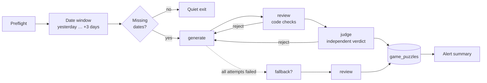

# Puzzle Lambdas

One AWS Lambda per daily game. Each runs once a night, writes puzzles a few
days ahead, and deploys on its own when its code changes. The product side of
each game — what it is and why — is in [games.md](./games.md).

---

## Layout

```
lambda/
├── shared/                      Used by every Lambda
│   ├── clients/                 AI providers, Supabase, Telegram/SNS (unchanged)
│   ├── constants/               Provider registry and per-provider config
│   ├── runtime/
│   │   ├── gameHandler.js       The lifecycle every game shares (below)
│   │   ├── preflight.js         Which providers/secrets a run needs
│   │   ├── store.js             game_puzzles reads and writes
│   │   ├── alerts.js            One alert per run, titled by game
│   │   ├── http.js              Timeouts, retries, Wikimedia-compliant User-Agent
│   │   ├── random.js            Seeded RNG: (game, date, attempt) → reproducible
│   │   ├── dates.js             Date window maths
│   │   └── match.js             Answer matching (mirrors the SPA's)
│   └── sources/wikipedia.js     Articles, aliases, page views, "On this day"
├── games/
│   ├── cryptic/                 The original clue pipeline, moved here intact
│   ├── sudoku/                  model · solver · generator · reviewer · judge
│   ├── what-am-i/               candidates · prompts · generator · reviewer · judge
│   ├── trivia/                  topics · prompts · generator · reviewer · judge · bank
│   ├── chronology/              selector · reviewer
│   ├── chess/                   lichess · reviewer · judge
│   └── cryptogram/              quotes · cipher · reviewer
└── scripts/
    ├── package.sh               Build one game's deployment zip
    └── preview.mjs              Generate a puzzle locally, no database
```

Every `games/<game>/index.js` exports `handler` — the Lambda entry point
(`games/<game>/index.handler`) — and, except cryptic, a `spec`.

---

## The lifecycle

`shared/runtime/gameHandler.js` runs every game except cryptic, which keeps
its own pipeline ([clue-pipeline.md](./clue-pipeline.md)).



- **generate** builds a candidate from the day's seed. On a retry it also
  receives the previous rejection's reasons (`ctx.feedback`), so an AI writer
  corrects itself instead of retrying blind.
- **review** is deterministic and free: shape, rules, grounding, no answer
  leaks. It never trusts the generator's own bookkeeping.
- **judge** is an independent verdict. For AI-written games it is a second
  model that plays the puzzle blind; for algorithmic games it re-solves or
  re-rates from the payload alone. A crashing judge rejects (fail-safe).
- **fallback** (Trivia only) supplies a non-AI candidate when every attempt
  fails: a hand-written question from `trivia/bank.js`.

| Game | Generator | Reviewer (code) | Judge |
|---|---|---|---|
| Variant Sudoku | Seeded fill → clues read off the grid → givens stripped while unique → softened to medium | Solution obeys every rule; givens agree; variant clues present; cages tile the grid | Re-solves from the payload: exactly one solution, the stored one, within the medium search budget |
| What Am I | Subject from `candidates.js`; clues by the AI from the Wikipedia article only | 5 clues, length, no answer/alias leak, every clue's evidence found in the source | Second model, blind: clue 1 alone must *not* solve it; all five *must*, and must be fair |
| Trivia | Subject from `topics.js` (chosen for a surprising backstory); the AI writes one 70–130-word story question from the article only | Length and shape, ends by asking, no multiple choice, no answer/alias leak, 3–5 facts each cited from the source, fact cited too | Second model, blind: the first two sentences alone must *not* solve it; the full question *must*, rated medium or hard (not easy, not obscure), and fair |
| Chronology | "On this day" feed: the most-read events and (deceased) people for the date, keyword-filtered for light topics, then screened by the judge model for suitability when a key is set | 6 events, distinct years, no year in the text, at least one close pair, none starts in place | Suitability screen (optional: falls back to keyword filters) |
| Checkmate | Lichess puzzle API, mate in 3–5 | chess.js replay: legal, ends in mate, length matches, no shorter mate | Rating 1300–1800 and ≥500 plays |
| Cryptogram | Unused quote from `quotes.js`, fresh derangement key, two mid-frequency givens | Length/variety band, valid key, givens present and not the commonest letter | — |

**Events** a handler accepts:

| Event | Effect |
|---|---|
| `{}` | Scheduled run: fill the window |
| `{ "dryRun": true }` | Preflight only. The deploy smoke test |
| `{ "preview": true, "date"?: "YYYY-MM-DD" }` | Generate, review and judge one puzzle; return it; no database |
| `{ "date": "YYYY-MM-DD" }` | Fill just that date |

---

## Data

Every game but cryptic writes `game_puzzles` (migration 004): one row per
`(game, puzzle_date)` with the frontend-ready `payload`, the `source_keys`
it was built from (so no Lichess puzzle, quote, answer or event repeats),
and the reviewer/judge record in `review`. Readers can see up to tomorrow
(UTC); the buffer beyond stays private.

The SPA reads the row for the player's **local** date
(`src/app/games/useDailyPuzzle.ts`), validates it
(`src/app/games/<game>/parse.ts`), and falls back to a built-in practice
puzzle — clearly labelled, never recorded — if it's missing or malformed.
`src/app/games/contract.test.ts` runs the real generators and asserts their
output parses on the frontend, so the two sides can't drift.

---

## Configuration

**Secrets** (GitHub → Settings → Secrets, environment `production`):

| Secret | Used by |
|---|---|
| `SUPABASE_URL`, `SUPABASE_SERVICE_ROLE_KEY` | Every Lambda |
| `GEMINI_API_KEY` (or another provider's key) | cryptic, what-am-i, trivia |
| `TELEGRAM_BOT_TOKEN` + `TELEGRAM_CHAT_ID`, and/or `SNS_TOPIC_ARN` | Alerts, every Lambda |
| `AWS_ACCESS_KEY_ID`, `AWS_SECRET_ACCESS_KEY`, `AWS_REGION`, `LAMBDA_ROLE_ARN` | Deploys |
| `LAMBDA_FUNCTION_NAME` | The cryptic Lambda's existing name (kept so it updates in place) |

Model keys are written only to the AI Lambdas' environments.

**Variables** (Settings → Variables):

| Variable | Default | Effect |
|---|---|---|
| `LAMBDA_NAME_PREFIX` | `crypticowl` | Functions are named `<prefix>-<game>` |
| `CONTACT_EMAIL` | site URL | Sent in the User-Agent. **Set it** — Wikimedia asks for a contact |
| `PUZZLE_DAYS_AHEAD` | `3` | Days generated ahead of today (0–14) |
| `AI_PROVIDER`, `JUDGE_PROVIDER` | `gemini` | Writer and judge models, as for cryptic |
| `<GAME>_SCHEDULE` | staggered 03:00–03:35 UTC | Per-game cron, e.g. `SUDOKU_SCHEDULE`; cryptic keeps `LAMBDA_SCHEDULE` |

| Lambda | Memory | Timeout | Default schedule (UTC) |
|---|---|---|---|
| sudoku | 1024 MB | 300 s | 03:00 |
| chronology | 256 MB | 300 s | 03:05 |
| chess | 512 MB | 300 s | 03:10 |
| cryptic | 256 MB | 600 s | 03:15 |
| cryptogram | 256 MB | 120 s | 03:20 |
| what-am-i | 256 MB | 600 s | 03:25 |
| trivia | 256 MB | 600 s | 03:35 |

---

## Deploying

- **Per game, automatic.** `deploy-lambda-<game>.yml` runs on a push to
  `master` that touches `lambda/games/<game>/`, `lambda/shared/`, the Lambda
  dependencies, or the deploy workflows. A shared change therefore redeploys
  every game.
- **All at once, manual.** Actions → *Deploy Lambdas · All games* — for the
  first deploy, or after rotating a shared secret.
- **Each deploy:** lint, format and test the game + shared code → package
  (`lambda/scripts/package.sh`, which imports the handler from the staged zip)
  → create or update the function (environment merged, never replaced) →
  reconcile its EventBridge schedule → publish a version → dry-run smoke test.
- **Pull requests:** CI packages and imports every game's Lambda, so a game
  that reaches outside its package fails before merge.

### First-time setup

1. Apply migrations 003 and 004: `supabase db push`.
2. Give the deploy user (`github-deploy-user`) the policy in
   [`iam/github-deploy-lambdas.json`](iam/github-deploy-lambdas.json): it may
   create and update `crypticowl-*` functions, their daily EventBridge rules
   and log groups, and pass the execution role to Lambda.
3. Set the secrets and `CONTACT_EMAIL` above.
4. Run *Deploy Lambdas · All games*. Each deploy also queues a first run, so
   puzzles appear within a few minutes rather than at 03:00.

---

## Running locally

```bash
node lambda/scripts/preview.mjs sudoku 2026-10-12
```

Prints the reviewed, judged payload the Lambda would store, without a
database. Sudoku, chronology, chess and cryptogram need only network access;
what-am-i and trivia also need a model key (`GEMINI_API_KEY=…`).

```bash
npx vitest run --project lambda
```

---

## Supply and alerts

| Pool | Size | Lasts | Alert |
|---|---|---|---|
| What Am I answers (`candidates.js`) | 194 in 11 categories | ~5 months unique (smallest category) | < 3 unused in any category |
| Cryptogram quotes (`quotes.js`) | 154 usable | ~5 months unique | < 45 unused |
| Trivia subjects (`topics.js`) | 323 in 9 categories | ~10 months unique, then least recent first | < 30 unused |
| Lichess puzzles | Millions | — | — |
| "On this day" | New each date | Events never repeat | — |

**Pools never run dry** (`shared/runtime/pool.js`): when every entry has been
used, a generator takes one not used in the last year, then six months, then
three. A forgotten top-up means an occasional repeat — What Am I gets fresh
clues from a different stretch of the article — never a missing day. The
low-stock alert fires well before that point.

The run alert lists each date created or failed and any low-stock warning. A
run with nothing to do sends nothing.

---

## Adding a game

1. `lambda/games/<game>/index.js` exporting `spec` and
   `handler = createGameHandler(spec)`; generator, reviewer, and a judge if
   there is an independent check worth making.
2. Add the game to the `game_puzzles.game` CHECK (new migration) and to
   `GAMES` in `src/app/games/registry.ts`.
3. Copy a `deploy-lambda-<game>.yml`, add a matrix row to
   `deploy-lambdas-all.yml` and to the `lambda-package` CI matrix.
4. A frontend `parse.ts` and a case in `contract.test.ts`.
